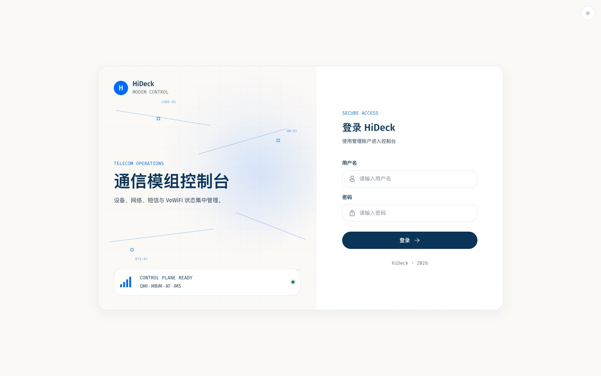
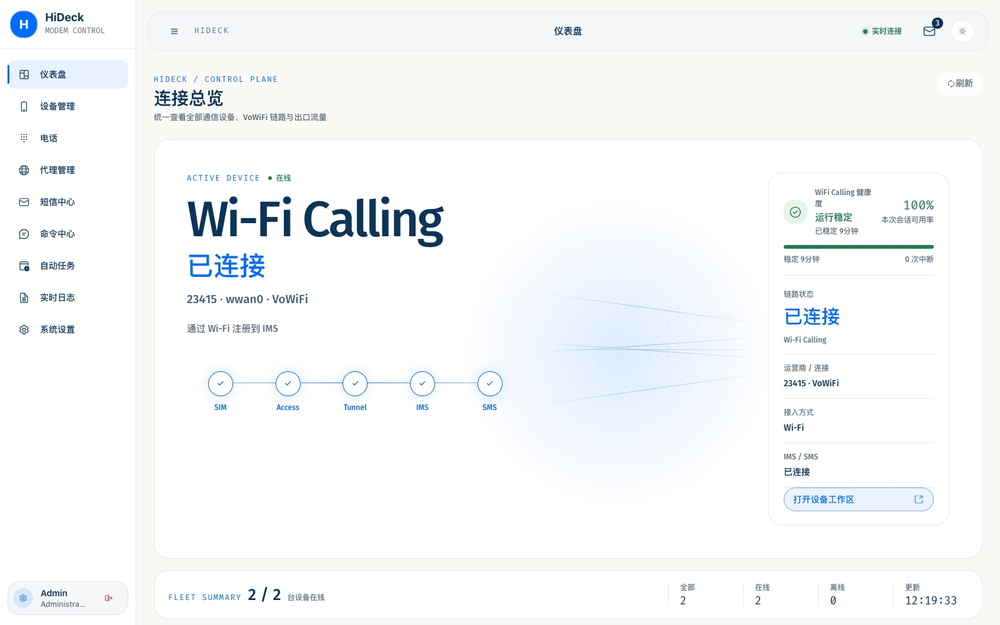
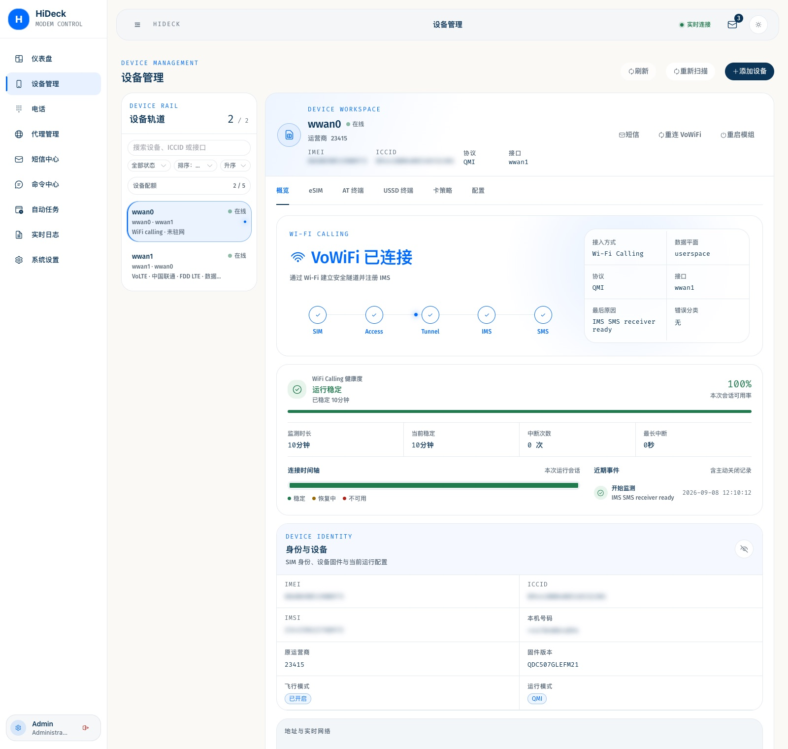
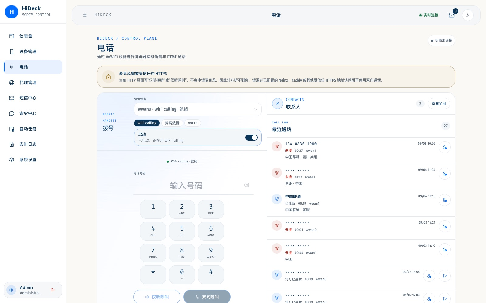
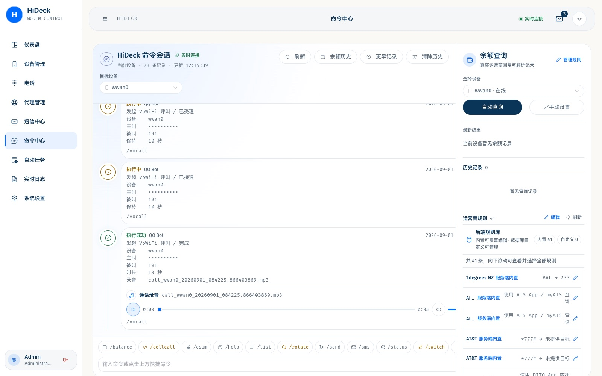
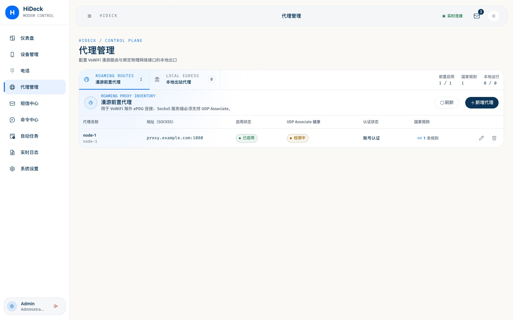

<div align="center">

# VESIM

**Self-hosted console for Qualcomm 4G / LTE / 5G modems**

**English** · [简体中文](i18n/README.zh-CN.md) · [日本語](i18n/README.ja.md) · [한국어](i18n/README.ko.md) · [Español](i18n/README.es.md) · [Français](i18n/README.fr.md) · [Deutsch](i18n/README.de.md) · [Português](i18n/README.pt-BR.md) · [Русский](i18n/README.ru.md)

<p>
  <a href="https://github.com/winniehu006/vesim/releases/latest"></a>
  <a href="https://hub.docker.com/r/winniehu006/vesim"></a>
  <a href="go.mod"></a>
  <a href="web/package.json"></a>
  <a href="LICENSE"></a>
</p>

</div>

Manage USB modems, cellular proxy, SMS, WiFi calling / IMS voice, eSIM, and scheduled tasks from a browser or an AI assistant via MCP.

> **VESIM** is a renamed fork of [HiDeck](https://github.com/yibaiba/hideck), based on upstream v2.1.35. The web console, backend and documentation are derived from HiDeck and remain under the PolyForm Noncommercial 1.0.0 license. This fork is not affiliated with or endorsed by the upstream author.

[Download v2.1.36](https://github.com/winniehu006/vesim/releases/tag/v2.1.36) · [Changelog](CHANGELOG.md) · [Connect an AI assistant](#mcp--ai-assistants)

| | |
| --- | --- |
| Web UI | `http://localhost:7575` |
| Default login | `admin` / `admin` (change on first sign-in) |
| Database | SQLite (`data/vesim.db`) |
| Release artifact | Windows portable zip (`vesim_*_windows_amd64.zip`) |

## Features

- **Devices** — USB auto-discovery; QMI, MBIM, AT, PC/SC; live radio and SIM identity
- **Proxy** — SOCKS5 / HTTP bound to the modem with `SO_BINDTODEVICE`
- **SMS** — inbox, send, contacts; vcf/csv from iOS, Google, Samsung, Xiaomi, Huawei, OPPO, vivo
- **Phone** — WiFi calling, cellular software IMS, or native VoLTE; hold, call waiting, listen-only answer
- **VoWiFi** — SWu / IMS, recordings; country proxy pool, pin a node, or go direct
- **Native VoLTE** — modem IMS (`phone_mode=volte`), no ePDG; unique China MBN mapping only
- **eSIM** — download, enable, disable, rename, delete; activation code or QR / PDF
- **MBN & SIM policies** — carrier profile library, automatic selection rules, manual trial runs
- **Automation & notify** — scheduled tasks; Telegram, email, Bark, Feishu, WeCom, WeChat, QQ
- **MCP** — 125 tools for devices, networking, SMS, contacts, calls, eSIM, MBN, proxies, commands, balance, tasks, and diagnostics

Protocol notes: [VoWiFi](docs/vowifi-protocol-alignment.md) · [VoLTE](docs/volte-native.md) · [operators](docs/operator-notes.md) · [hardware](docs/modem-hardware.md) · [module voice troubleshooting](docs/modem-voice-troubleshooting.md)

Outgoing call/SMS quotas are per SIM and survive restarts: [limits and configuration](docs/outbound-limits.md).

Modem carrier profiles: [MBN management, SIM policies and manual trial runs](docs/mbn.md).

WebDAV backup and safe local cleanup: [archive SMS, calls and recordings](docs/webdav-archive.md).

## Quick start (Windows)

Download `vesim_v2.1.36_windows_amd64.zip` from [Releases](https://github.com/winniehu006/VESIM/releases/tag/v2.1.36), unzip it anywhere, run `start-vesim.bat`, then open <http://localhost:7575> (default `admin` / `admin`, change on first sign-in). No installer, no service, no Linux host required — the Windows portable zip is the only release artifact this fork publishes.

Or build it yourself:

```powershell
.\build-windows.ps1
```

The script compiles the Vue frontend and the Go backend and writes `dist\vesim_v2.1.36_windows_amd64.zip`. It needs Go 1.26+ and Node.js 20+; use `-GoBin <path>` when Go is not on `PATH`, and `-SkipFrontend` when `web/` was already built. When `-Version` is omitted the newest git tag decides the version.

On Windows the console starts with no devices — QMI/MBIM/AT access, VoWiFi, USB audio, host-network proxy binding and udev hot-plug need Linux with host USB access.

### Legacy Linux / Docker / OpenWrt

The upstream HiDeck Linux paths are still in this tree (`Dockerfile*`, `docker-compose*.yml`, `deploy*.sh`, `packaging/openwrt`, `packaging/fnos`, `Makefile`) and remain the only way to drive real modem hardware, but this fork no longer builds, publishes or tests them. Use [upstream HiDeck](https://github.com/yibaiba/hideck) for modem deployments.

## MCP / AI assistants

VESIM includes a remote MCP server using Streamable HTTP. It shares the existing HTTP/HTTPS port at `/mcp` and is disabled by default. The Agent connects to your running VESIM instance; no separate VESIM MCP server installation is needed on the Agent's machine.

1. Sign in to VESIM and accept the current disclaimer. Enable MCP in **Settings → MCP**, then create a named token. Save it when shown: the plaintext is displayed only once.
2. Choose your client and copy its configuration, or use **Copy for Agent** (「复制给 Agent」) to let an Agent with local configuration access merge it into the existing settings.
3. Use an address reachable from the Agent, such as `http://YOUR_IP:7575/mcp` or `https://vesim.example.com/mcp`. Reload the client and ask it to list devices to verify the connection.

Configuration templates are available for **Codex, Claude Code, Cursor, Gemini CLI, Hermes Agent, DeepSeek dsh, Pi Agent, and Grok Build**. Client version requirements and verification coverage are documented in the [MCP guide](docs/mcp.md) and [validation notes](docs/mcp-validation.md).

Tokens grant all exposed business permissions and can be revoked or deleted in Settings. They cannot be used for web login or REST administration. All 125 tools provide input/output schemas and usage guidance; write operations are not automatically retried. System upgrades, uninstall, login credentials, and notification secrets are not exposed.

For browser-audio call control, open the Phone page, select **Connect MCP** (「连接 MCP」), authorize the token and microphone, and keep the page open. The Agent selects an authorized `audio_connection_id`; audio continues through the browser's existing WebRTC session. See [HTTPS / WebRTC](docs/https-webrtc.md) for microphone requirements.

Use **Check connection** (「检查接入」) in Settings for server readiness and recent token activity. Tool calls appear in the existing **Live Logs** page; search for `MCP tool`. See the [MCP guide](docs/mcp.md) for authentication, reverse-proxy troubleshooting, tool contracts, and capability limits.

Screenshots below come from the upstream HiDeck release; the VESIM UI is identical apart from branding.

## Screenshots





| Devices | Phone |
| --- | --- |
|  |  |

| Commands | Proxy |
| --- | --- |
|  |  |


## Configuration

Copy [config/config.example.yaml](config/config.example.yaml) to `config/config.yaml`.

| Key | Default | Notes |
| --- | --- | --- |
| `server.port` | `7575` | HTTP |
| `server.https_enabled` | `false` | Built-in HTTPS; keep off behind a reverse proxy |
| `server.https_port` | `7576` | Built-in HTTPS port |
| `server.webrtc_udp_address` | `:7580` | WebRTC audio UDP |
| `server.webrtc_public_host` | empty | Public ICE host behind NAT |
| `web.username` / `web.password` | `admin` | Change immediately |
| `vowifi.enabled` | `false` | Global VoWiFi |
| `mcp.enabled` | `false` | Remote MCP; manage independent tokens in Settings |
| `system.openwrt_dynamic_interfaces` | `false` | OpenWrt netifd mapping |

Do not commit secrets. SIM PIN fields store environment variable *names* only (`VESIM_SIM_PIN_READER1`). `PROXY_WEB_PASSWORD` overrides the file.

## Build

Windows portable is the only artifact this fork produces.

```powershell
.\build-windows.ps1                              # frontend + backend + dist\vesim_v2.1.36_windows_amd64.zip
.\build-windows.ps1 -GoBin C:\go\bin -SkipFrontend
```

Prerequisites: Go `1.26.4+`, Node.js 20+. The build is `CGO_ENABLED=0` with the `with_utls nomsgpack` tags, so nothing else is installed.

Checks:

```bash
npm test --prefix web        # 397 frontend tests
npm run typecheck --prefix web
go test ./cmd/... ./internal/... ./pkg/...
```

Cross-compiling a Linux binary is still possible (`GOOS=linux CGO_ENABLED=0 go build -tags "with_utls nomsgpack" -o dist/vesim_linux_amd64 ./cmd/vesim`) but is not published or tested here.

Dev proxy: `VITE_API_PROXY_TARGET=http://127.0.0.1:7575` in `web/.env.local`. API docs: `/api/docs`.

## Release

Tag the commit and push the tag. `.github/workflows/windows-release.yml` builds `vesim_<version>_windows_amd64.zip` on a Windows runner and attaches it — plus its `.sha256` — to the release, creating the release if needed:

```bash
git tag v2.1.36
git push origin v2.1.36
```

The tag also works for an existing release: assets are re-uploaded with `--clobber`. Manual rebuild: Actions → **Windows release** → Run workflow, with the version in the input.

## License

Personal learning, research, and testing. Not a production telephony stack. Independent of Quectel, Qualcomm, and carriers. Follow local law and your operator’s terms.

[PolyForm Noncommercial 1.0.0](LICENSE). `third_party/vowifi-go` is AGPL-3.0. See [THIRD_PARTY_NOTICES.md](THIRD_PARTY_NOTICES.md) before distributing binaries or images.

Thanks: [LINUX DO](https://linux.do/) · [iniwex5/vohive-release](https://github.com/iniwex5/vohive-release) · [boa-z/vowifi-go](https://github.com/boa-z/vowifi-go)
