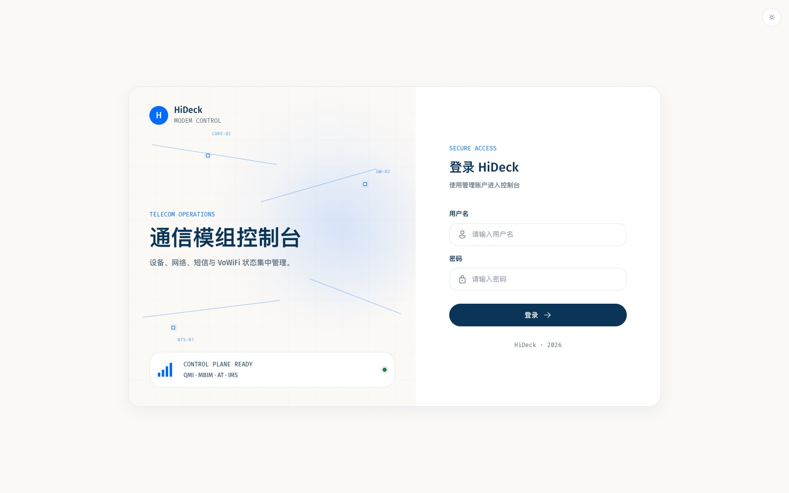
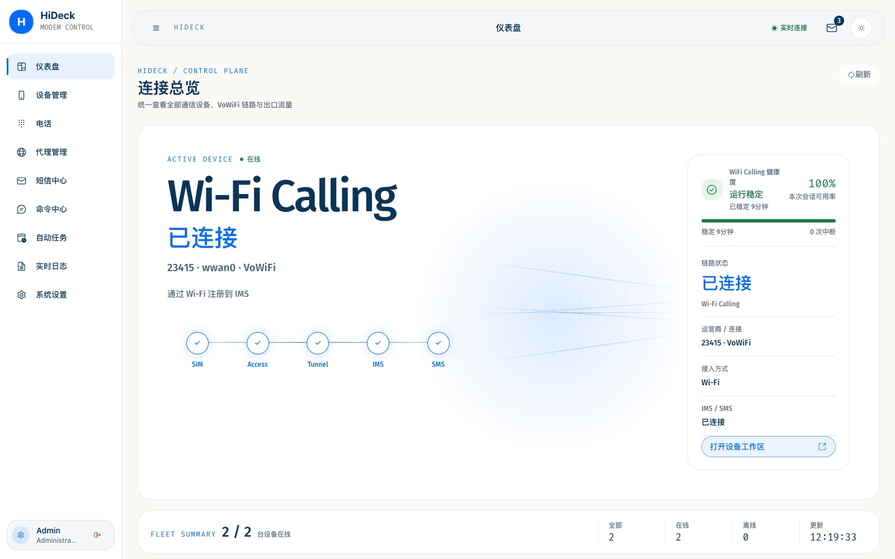
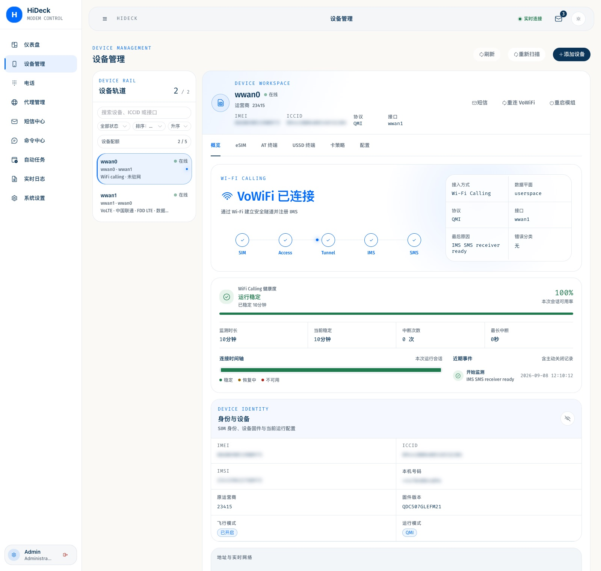
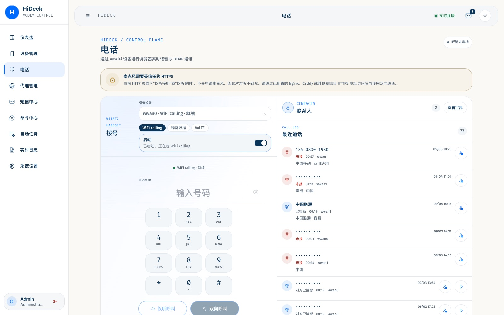
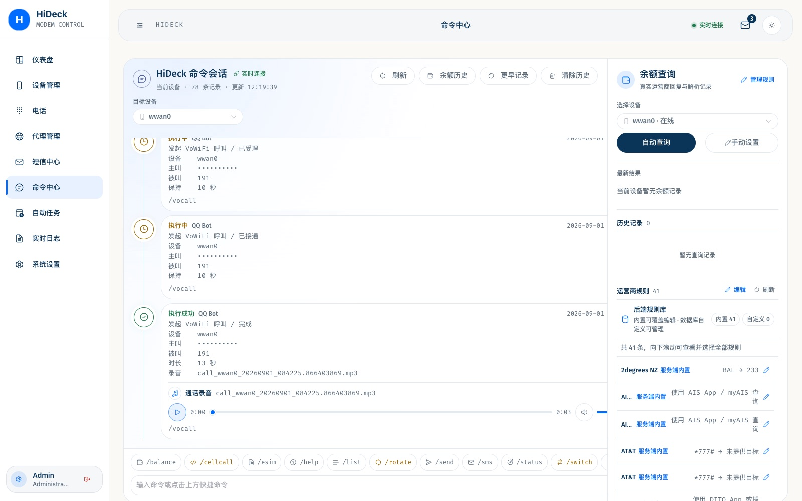
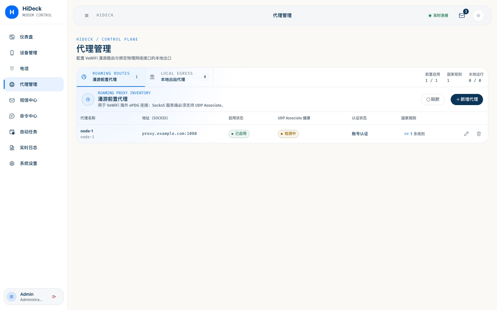

<div align="center">

# VESIM

**Consola autoalojada para módems Qualcomm 4G / LTE / 5G**

[English](../README.md) · [简体中文](README.zh-CN.md) · [日本語](README.ja.md) · [한국어](README.ko.md) · **Español** · [Français](README.fr.md) · [Deutsch](README.de.md) · [Português](README.pt-BR.md) · [Русский](README.ru.md)

<p>
  <a href="https://github.com/winniehu006/vesim/releases/latest"></a>
  <a href="https://hub.docker.com/r/winniehu006/vesim"></a>
  <a href="../go.mod"></a>
  <a href="../web/package.json"></a>
  <a href="../LICENSE"></a>
</p>

</div>

Gestiona módems USB, proxy celular, SMS, WiFi calling / voz IMS, eSIM y tareas programadas desde el navegador.

| | |
| --- | --- |
| Interfaz web | `http://YOUR_IP:7575` |
| Acceso por defecto | `admin` / `admin` (cámbialo en el primer inicio de sesión) |
| Base de datos | SQLite (`data/vesim.db`) |

## Funciones

- **Dispositivos** — descubrimiento USB; QMI, MBIM, AT, PC/SC; radio y SIM en tiempo real
- **Proxy** — SOCKS5 / HTTP ligado al módem con `SO_BINDTODEVICE`
- **SMS** — bandeja, envío, contactos; vcf/csv de iOS, Google, Samsung, Xiaomi, Huawei, OPPO, vivo
- **Teléfono** — WiFi calling, IMS por software celular o VoLTE nativo; espera, llamada en espera, respuesta solo-escucha
- **VoWiFi** — SWu / IMS, grabaciones; pool de proxies por país, fijar un nodo o ir directo
- **VoLTE nativo** — IMS del módem (`phone_mode=volte`), sin ePDG; solo el mapeo MBN único de China
- **eSIM** — descargar, activar, desactivar, renombrar, borrar; código de activación o QR / PDF
- **Automatización y avisos** — tareas programadas; Telegram, correo, Bark, Feishu, WeCom, WeChat, QQ

Notas de protocolo: [VoWiFi](../docs/vowifi-protocol-alignment.md) · [VoLTE](../docs/volte-native.md) · [operadores](../docs/operator-notes.md) · [hardware](../docs/modem-hardware.md)

## MCP / asistentes de IA

VESIM ofrece 125 herramientas MCP para dispositivos, redes, SMS, contactos, llamadas, eSIM, MBN, proxies, comandos, saldo, tareas y diagnóstico. El servicio está desactivado por defecto. Actívelo en «MCP 接入» en los ajustes y cree un token independiente; el token completo se muestra una sola vez.

Hay plantillas para Codex, Claude Code, Cursor, Gemini CLI, Hermes Agent, DeepSeek dsh, Pi Agent y Grok Build. Copie la configuración o use «复制给 Agent» para que un Agent con acceso a su configuración local la integre. La conexión usa Streamable HTTP con VESIM ya en ejecución; no hace falta instalar otro servidor MCP de VESIM en el equipo del Agent.

Use `http://YOUR_IP:7575/mcp` o la misma ruta por HTTPS. Los tokens tienen todos los permisos de negocio expuestos y pueden revocarse o eliminarse en los ajustes. Para controlar llamadas con audio del navegador, autorice el token mediante «连接 MCP» en la página de teléfono y manténgala abierta.

Consulte la [guía MCP](../docs/mcp.md) (en chino) para la configuración, los requisitos de audio, el diagnóstico y el alcance.

## Inicio rápido

Docker (recomendado). Hace falta Linux, curl, Docker Compose, red host y acceso USB. La imagen incluye librerías AMR/MP3 para grabar llamadas.

```bash
curl -fsSL https://raw.githubusercontent.com/winniehu006/vesim/main/deploy.sh | sh
```

```bash
curl -fsSL https://raw.githubusercontent.com/winniehu006/vesim/main/deploy.sh | VESIM_DIR=/opt/vesim sh
```

Abre `http://YOUR_IP:7575`.

Con un nombre público (DNS A/AAAA al host, puertos `443/TCP` y `443/UDP` abiertos):

```bash
curl -fsSL https://raw.githubusercontent.com/winniehu006/vesim/main/deploy.sh | \
  VESIM_DOMAIN=vesim.example.com \
  VESIM_DIR=/opt/vesim sh
```

Imagen: `winniehu006/vesim:latest`. Compose usa `network_mode: host`, `privileged: true`, `/dev`, y persiste `config/`, `data/`, `logs/`. Ver [DOCKERHUB.md](../DOCKERHUB.md) y [HTTPS / WebRTC](../docs/https-webrtc.md).

```bash
docker compose ps
docker compose logs -f vesim
```

## Capturas





| Dispositivos | Teléfono |
| --- | --- |
|  |  |

| Comandos | Proxy |
| --- | --- |
|  |  |

## Instalación binaria

```bash
curl -fsSL https://raw.githubusercontent.com/winniehu006/vesim/main/deploy-binary.sh | sh
```

```bash
curl -fsSL https://raw.githubusercontent.com/winniehu006/vesim/main/deploy-binary.sh | \
  VESIM_DIR=/opt/vesim \
  VESIM_VERSION=v2.1.35 \
  VESIM_ARCH=linux_amd64 sh
```

| Archivo | Plataforma |
| --- | --- |
| `vesim_v2.1.35_linux_amd64` | x86_64, glibc + UPX |
| `vesim_v2.1.35_linux_arm64` | ARM64 / Raspberry Pi OS 64-bit, glibc + UPX |
| `vesim_v2.1.35_linux_armv7` | ARM 32-bit, glibc + UPX |
| `vesim_v2.1.35_openwrt_amd64` | OpenWrt x86_64, musl estático, sin UPX |
| `vesim_v2.1.35_openwrt_arm64` | OpenWrt aarch64 |
| `vesim_v2.1.35_openwrt_armv7` | OpenWrt ARM 32-bit |

En OpenWrt usa solo `openwrt_*`. Ver [packaging/openwrt/README.md](../packaging/openwrt/README.md).

## Configuración

Copia [config/config.example.yaml](../config/config.example.yaml) a `config/config.yaml`.

| Clave | Por defecto | Notas |
| --- | --- | --- |
| `server.port` | `7575` | HTTP |
| `server.https_enabled` | `false` | HTTPS integrado; déjalo apagado detrás de un proxy inverso |
| `server.https_port` | `7576` | Puerto HTTPS integrado |
| `server.webrtc_udp_address` | `:7580` | UDP de audio WebRTC |
| `server.webrtc_public_host` | vacío | Host ICE público detrás de NAT |
| `web.username` / `web.password` | `admin` | Cámbialo de inmediato |
| `vowifi.enabled` | `false` | VoWiFi global |
| `system.openwrt_dynamic_interfaces` | `false` | Mapeo netifd de OpenWrt |

No subas secretos. Los campos SIM PIN guardan solo *nombres* de variables de entorno (`VESIM_SIM_PIN_READER1`). `PROXY_WEB_PASSWORD` pisa el archivo.

## Compilación

Go `1.26.4+`, Node.js / npm. `make build-*` necesita UPX.

```bash
make build-amd64    # también: build-arm64, build-armv7, build-all
```

```bash
npm ci --prefix web && npm run build --prefix web
cp -R web/dist internal/web/dist
GOWORK=off CGO_ENABLED=0 GOOS=linux GOARCH=amd64 \
  go build -trimpath -tags "with_utls nomsgpack" -o dist/vesim_linux_amd64 ./cmd/vesim
```

```bash
npm test --prefix web && npm run typecheck --prefix web
go test -timeout=60s ./cmd/... ./internal/... ./pkg/...
```

Proxy de desarrollo: `VITE_API_PROXY_TARGET=http://127.0.0.1:7575` en `web/.env.local`. API: `/api/docs`.

## Licencia

Aprendizaje, investigación y pruebas personales. No es una centralita de producción. Independiente de Quectel, Qualcomm y los operadores. Cumple la ley local y las condiciones de tu operador.

[PolyForm Noncommercial 1.0.0](../LICENSE). `third_party/vowifi-go` es AGPL-3.0. Lee [THIRD_PARTY_NOTICES.md](../THIRD_PARTY_NOTICES.md) antes de distribuir binarios o imágenes.

Thanks: [LINUX DO](https://linux.do/) · [iniwex5/vohive-release](https://github.com/iniwex5/vohive-release) · [boa-z/vowifi-go](https://github.com/boa-z/vowifi-go)
