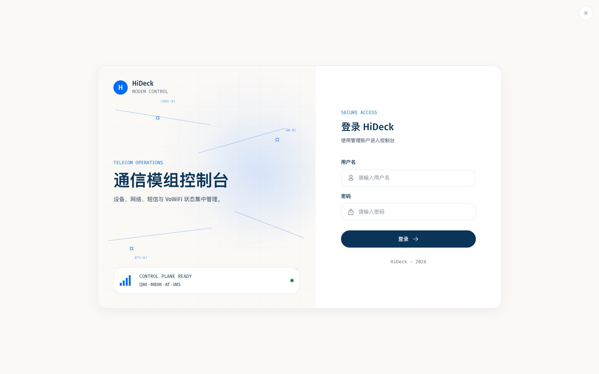
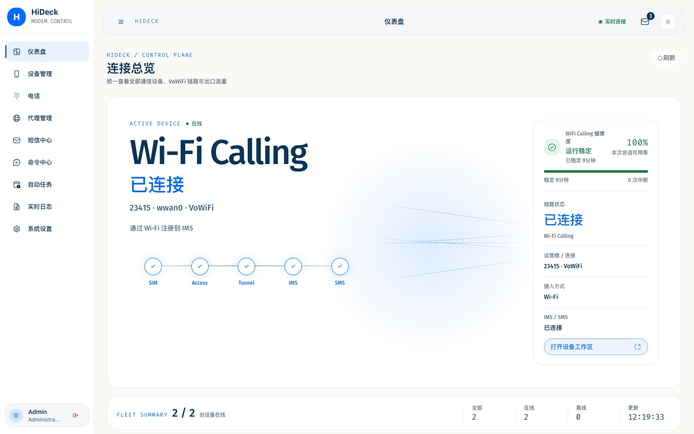
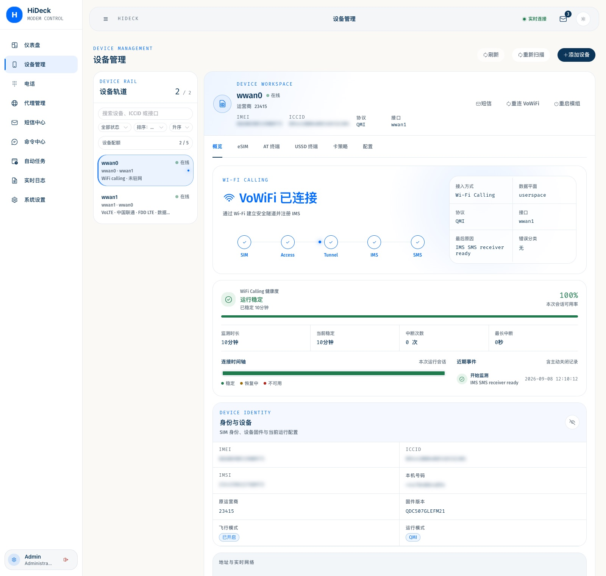
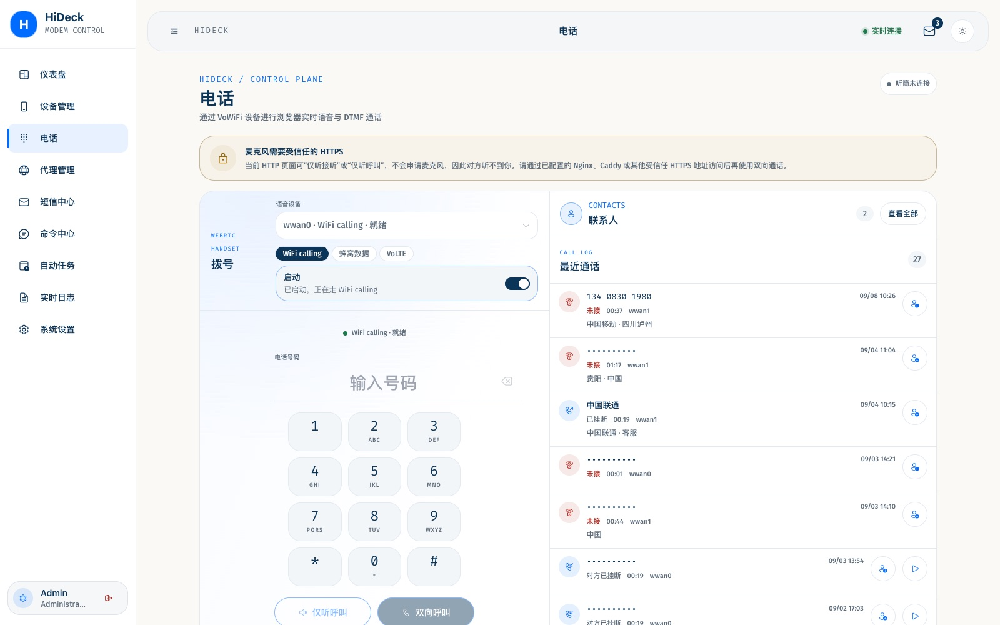
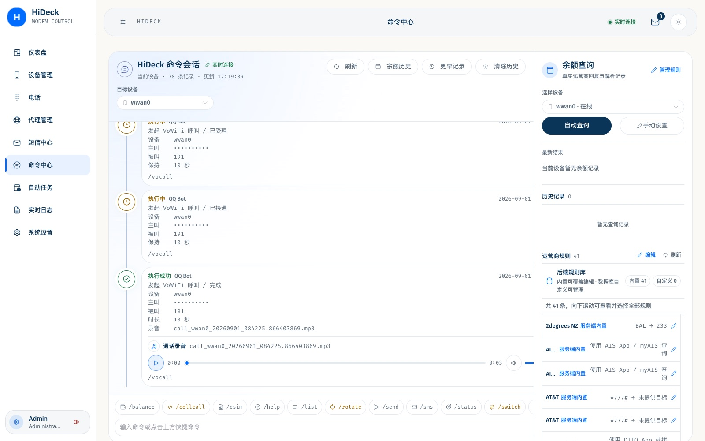
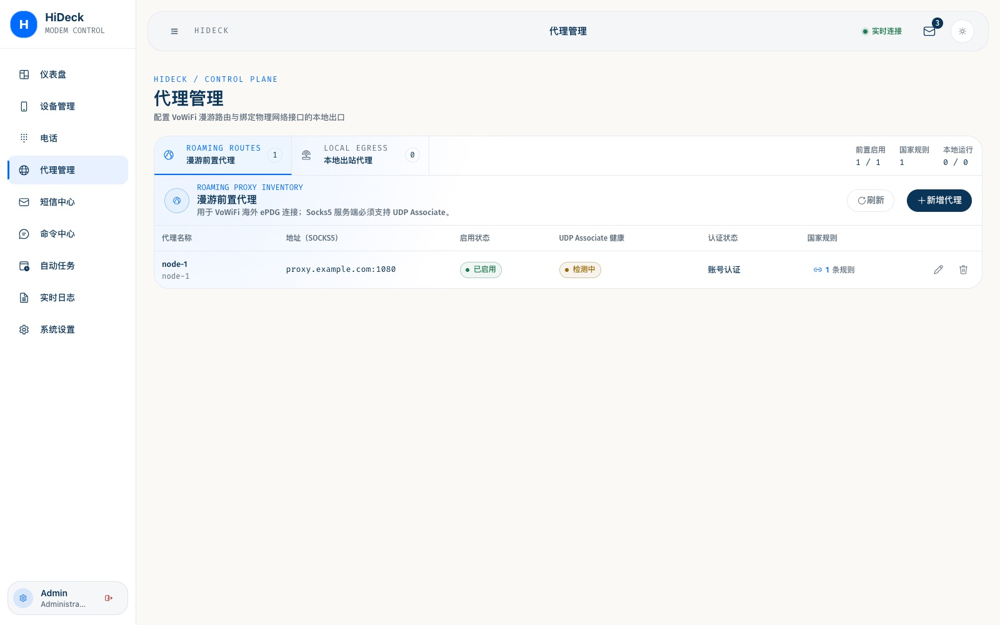

<div align="center">

# VESIM

**面向高通 4G / LTE / 5G 模组的自托管控制台**

[English](../README.md) · **简体中文** · [日本語](README.ja.md) · [한국어](README.ko.md) · [Español](README.es.md) · [Français](README.fr.md) · [Deutsch](README.de.md) · [Português](README.pt-BR.md) · [Русский](README.ru.md)

<p>
  <a href="https://github.com/winniehu006/vesim/releases/latest"></a>
  <a href="https://hub.docker.com/r/winniehu006/vesim"></a>
  <a href="../go.mod"></a>
  <a href="../web/package.json"></a>
  <a href="../LICENSE"></a>
</p>

</div>

通过浏览器或支持 MCP 的 AI 助手管理 USB 模组、蜂窝代理、短信、WiFi calling / IMS 通话、eSIM 和自动任务。

> **VESIM** 是 [HiDeck](https://github.com/yibaiba/hideck) 的改名分支，基于上游 v2.1.35。网页控制台、后端与文档均来自 HiDeck，继续遵循 PolyForm Noncommercial 1.0.0 许可。本分支与上游作者无隶属或背书关系。

[下载 v2.1.35](https://github.com/winniehu006/vesim/releases/tag/v2.1.35) · [更新记录](../CHANGELOG.md) · [接入 AI 助手](#mcp--ai-助手)

| | |
| --- | --- |
| Web | `http://localhost:7575` |
| 默认账号 | `admin` / `admin`（弱密码会要求立刻修改） |
| 数据库 | SQLite（`data/vesim.db`） |
| 发布产物 | 仅 Windows 便携包（`vesim_*_windows_amd64.zip`） |

## 功能

- **设备** — USB 自动发现；QMI、MBIM、AT、PC/SC；实时射频和卡身份
- **代理** — SOCKS5 / HTTP，用 `SO_BINDTODEVICE` 绑到模组网卡
- **短信** — 收发、会话、联系人；iOS / Google / 三星 / 小米 / 华为 / OPPO / vivo 的 vcf、csv
- **电话** — WiFi calling、蜂窝软件 IMS、原生 VoLTE；保持、呼叫等待、仅听接听
- **VoWiFi** — SWu / IMS、录音；国家代理池、钉死节点或直连
- **原生 VoLTE** — 模组 IMS（`phone_mode=volte`），不建 ePDG；仅国内唯一 MBN 画像才自动选
- **eSIM** — 下载、启用、停用、重命名、删除；激活码或二维码 / PDF
- **MBN 与 SIM 策略** — 运营商配置文件库、自动选择规则、手动试运行
- **自动任务与通知** — 按计划执行；Telegram、邮件、Bark、飞书、企微、微信、QQ
- **MCP** — 125 项工具，覆盖设备、网络、短信、联系人、电话、eSIM、MBN、代理、命令、余额、任务和诊断

协议说明：[VoWiFi](../docs/vowifi-protocol-alignment.md) · [VoLTE](../docs/volte-native.md) · [运营商](../docs/operator-notes.md) · [硬件](../docs/modem-hardware.md) · [模组直拨排障](../docs/modem-voice-troubleshooting.md)

外呼/短信按 SIM 独立限流，重启保留计数：[额度与配置说明](../docs/outbound-limits.md)。

模组运营商配置：[MBN 管理、SIM 策略与手动试运行](../docs/mbn.md)。

WebDAV 备份与本地清理：[归档短信、通话记录与录音](../docs/webdav-archive.md)。

## 快速开始（Windows）

从[发布页](https://github.com/winniehu006/VESIM/releases/tag/v2.1.35)下载 `vesim_v2.1.35_windows_amd64.zip`，解压后运行 `start-vesim.bat`，浏览器打开 <http://localhost:7575>（默认 `admin` / `admin`，首次登录会要求修改）。免安装、免服务、无需 Linux 主机——本分支只发布这一个 Windows 便携包。

也可以自己编译：

```powershell
.\build-windows.ps1
```

脚本会编译前端与后端，生成 `dist\vesim_v2.1.35_windows_amd64.zip`。需要 Go 1.26+ 与 Node.js 20+，可用 `-GoBin` 指定 Go，用 `-SkipFrontend` 跳过已构建过的前端。

Windows 下不会发现模组：QMI/MBIM/AT、VoWiFi、USB 音频、按网卡绑定出站和 udev 热插拔都需要 Linux 且拥有 USB 直通。

### 历史遗留：Linux / Docker / OpenWrt

上游 HiDeck 的 Linux 相关文件仍在仓库中（`Dockerfile*`、`docker-compose*.yml`、`deploy*.sh`、`packaging/openwrt`、`packaging/fnos`、`Makefile`），它们仍是唯一能驱动真实模组硬件的部署方式，但本分支不再构建、发布或验证它们。模组部署请使用[上游 HiDeck](https://github.com/yibaiba/hideck)。
## MCP / AI 助手

VESIM 内置远程 MCP 服务，采用 Streamable HTTP，与现有 HTTP/HTTPS 共用端口，地址为 `/mcp`，默认关闭。Agent 直接连接已经运行的 VESIM，无需在 Agent 所在机器另装 VESIM MCP 服务端。

1. 登录网页并确认当前版本的免责声明，在 **设置 → MCP 接入** 开启服务，创建有明确名称的令牌。明文只显示一次，创建后及时保存。
2. 选择客户端并复制连接配置；也可点击 **复制给 Agent**，让有本机配置权限的 Agent 合并配置，保留原有设置。
3. 使用 Agent 能访问的地址，例如 `http://YOUR_IP:7575/mcp` 或 `https://vesim.example.com/mcp`。重载客户端后，让它列出设备验证连接。

网页提供 **Codex、Claude Code、Cursor、Gemini CLI、Hermes Agent、DeepSeek dsh、Pi Agent、Grok Build** 八种配置模板。客户端版本要求与实际验证范围见 [MCP 接入文档](../docs/mcp.md)和[验证说明](../docs/mcp-validation.md)。

令牌拥有已开放的全部业务权限，可在设置中撤销或删除，不能用于网页登录或 REST 管理接口。125 项工具均提供输入、输出契约和调用说明，写操作不会自动重试；不开放系统升级、卸载、登录凭据和通知密钥配置。

需要网页音频控制通话时，在电话页点击 **连接 MCP**，选择令牌并授权麦克风，保持网页打开。Agent 使用已授权的 `audio_connection_id` 操作通话，音频仍通过网页现有 WebRTC 会话传输。麦克风访问条件见 [HTTPS / WebRTC](../docs/https-webrtc.md)。

设置中的 **检查接入** 可查看服务是否就绪及令牌最近请求、调用记录。工具调用日志在现有 **实时日志** 页面，搜索 `MCP tool` 筛选。鉴权、反向代理排查、工具契约与能力限制见 [MCP 接入文档](../docs/mcp.md)。

## 截图





| 设备 | 电话 |
| --- | --- |
|  |  |

| 命令 | 代理 |
| --- | --- |
|  |  |

## 配置

复制 [config/config.example.yaml](../config/config.example.yaml) 为 `config/config.yaml`。

| 项 | 默认 | 说明 |
| --- | --- | --- |
| `server.port` | `7575` | HTTP |
| `server.https_enabled` | `false` | 内置 HTTPS；前面有反代时关掉 |
| `server.https_port` | `7576` | 内置 HTTPS 端口 |
| `server.webrtc_udp_address` | `:7580` | WebRTC 音频 UDP |
| `server.webrtc_public_host` | 空 | NAT 后 ICE 公网地址 |
| `web.username` / `web.password` | `admin` | 请立刻改 |
| `vowifi.enabled` | `false` | 全局 VoWiFi |
| `mcp.enabled` | `false` | 远程 MCP；独立令牌在网页设置中管理 |
| `system.openwrt_dynamic_interfaces` | `false` | 仅 OpenWrt |

不要把密钥提交进仓库。SIM PIN 只存环境变量名（`VESIM_SIM_PIN_READER1`）。`PROXY_WEB_PASSWORD` 优先于配置文件。

## 构建

本分支只产出 Windows 便携包：

```powershell
.\build-windows.ps1                              # 前端 + 后端 + dist\vesim_v2.1.35_windows_amd64.zip
.\build-windows.ps1 -GoBin C:\go\bin -SkipFrontend
```

前置条件：Go `1.26.4+`、Node.js 20+。构建为 `CGO_ENABLED=0` 加 `with_utls nomsgpack` 标签，不依赖其他工具。

自检：

```bash
npm test --prefix web        # 397 个前端测试
npm run typecheck --prefix web
go test ./cmd/... ./internal/... ./pkg/...
```

仍可按 `GOOS=linux CGO_ENABLED=0 go build -tags "with_utls nomsgpack" -o dist/vesim_linux_amd64 ./cmd/vesim` 交叉编译 Linux 版，但本分支不发布、不验证。

开发代理：`web/.env.local` 里 `VITE_API_PROXY_TARGET=http://127.0.0.1:7575`。接口文档：`/api/docs`。

## 发布

打 tag 并推送即可。`.github/workflows/windows-release.yml` 会在 Windows Runner 上编译 `vesim_<version>_windows_amd64.zip`（含 `.sha256`），并挂到对应 Release 上，Release 不存在时自动创建：

```bash
git tag v2.1.36
git push origin v2.1.36
```

如果该 tag 的 Release 已存在，会用 `--clobber` 覆盖同名产物。也可手动触发：Actions → **Windows release** → Run workflow，在输入框填版本号。

## 许可

仅供个人学习、研究和测试，不是生产话务平台。与 Quectel、高通、运营商无官方关系。遵守当地法律和运营商条款。

[PolyForm Noncommercial 1.0.0](../LICENSE)。`third_party/vowifi-go` 为 AGPL-3.0。分发二进制或镜像前阅读 [THIRD_PARTY_NOTICES.md](../THIRD_PARTY_NOTICES.md)。

感谢：[LINUX DO](https://linux.do/) · [iniwex5/vohive-release](https://github.com/iniwex5/vohive-release) · [boa-z/vowifi-go](https://github.com/boa-z/vowifi-go)
